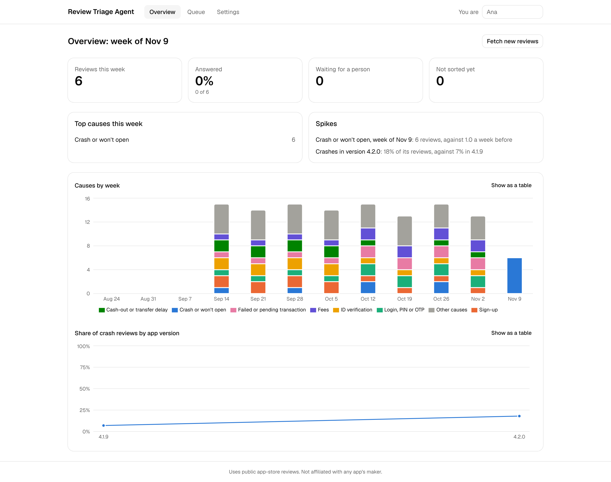
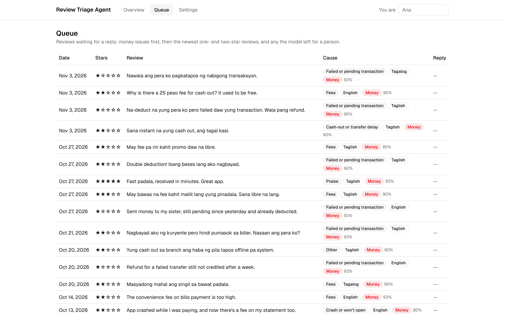
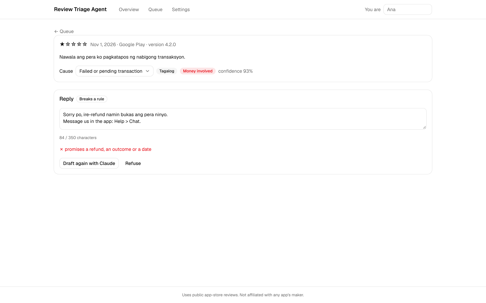
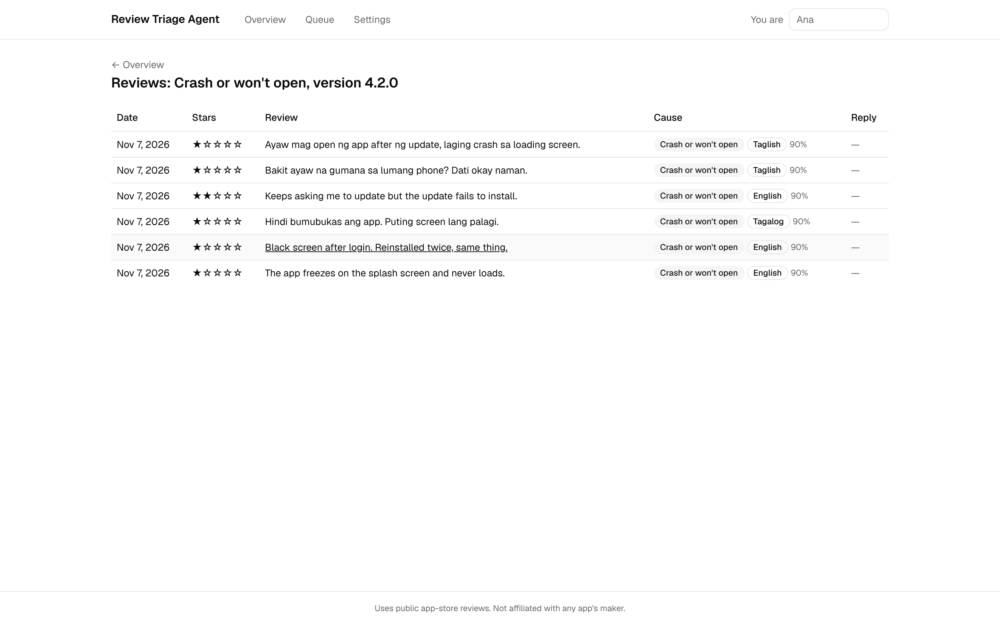
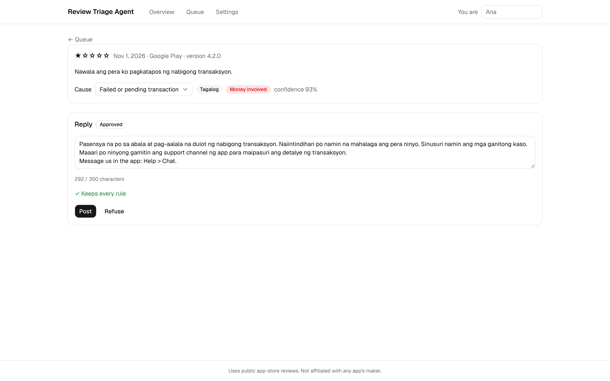

# Review Triage Agent

**An AI agent that turns an app's public reviews into sorted issues, spikes and replies a person approves.**

Popular apps collect thousands of public reviews, and many unhappy ones are never answered. Together they hold a bug report nobody reads: which release crashes, where sign-up fails, when money goes missing. This agent reads them for a support team and an engineering lead:

- it **fetches** an app's reviews from Google Play and the App Store, and **drops reviewer names** before anything is stored;
- **Claude sorts** each review by cause (crash, login, failed transaction, cash-out delay and more), language (English, Tagalog or Taglish) and whether money is involved, with a confidence; **unsure or unreadable answers go to a person**, never to a guessed cause;
- it **spots spikes**: a cause that doubles its four-week average, and an app version whose crash share doubles the previous version's;
- **Claude drafts replies** in the reviewer's language, and **code checks every reply**, the model's or a person's: no promised refunds or dates, no asking for account numbers, PINs or OTPs, no blaming the customer, 350 characters, the support channel at the end. A broken draft is redrafted once, then left for a person;
- **a person approves the exact text**; the approval is bound to a fingerprint of that text, so any edit needs a new approval, and each reply is **posted once**, even after a crash;
- **every** draft, edit, approval, refusal and post is in an **append-only log**;
- **Claude can use it through MCP** (search, summarise, list spikes, draft), and an **n8n workflow emails a daily summary**.

It works for any app on Google Play or the App Store. It uses public reviews only and is **not affiliated with any app's maker**.



**See it working:** a [walkthrough video](docs/showcase/walkthrough.mp4) (about a minute and a half) and more screenshots in [`docs/showcase/`](docs/showcase/), all of made-up reviews.

|                                                                                               |                                                                                                 |
| --------------------------------------------------------------------------------------------- | ----------------------------------------------------------------------------------------------- |
|                        |  |
| The queue: money complaints first                                                             | A promised refund, caught before anyone approves it                                             |
|  |                        |
| The reviews behind a spike                                                                    | Approved exactly as written, ready to post once                                                 |

## Try it

The demo needs no API key: 120 made-up reviews of a fictional finance app, already sorted, with a crash spike this week.

```sh
pnpm install && pnpm --dir web install && pnpm --dir web build
pnpm cli load-demo     # the made-up reviews, into data/reviews.db
pnpm cli serve         # the dashboard, at http://127.0.0.1:4317
```

Type your name at the top, open the queue, write a reply (try promising a refund), fix it, approve it and post it. Posting goes to a stand-in that only records it: nothing reaches a real app.

With your own Anthropic API key in `.env` (`cp .env.example .env`), "Draft with Claude" and "Fetch new reviews" work live: choose an app on the settings page by its store IDs. In a Claude Code cloud session, set the key as the environment variable `OWNER_ANTHROPIC_API_KEY` instead, since Claude Code itself reads `ANTHROPIC_API_KEY`.

The same from the command line:

```sh
pnpm cli fetch          # new reviews of the app chosen in the settings (or --play/--apple)
pnpm cli sort           # sort them with Claude
pnpm cli summary        # this week's numbers and the spikes
pnpm cli draft          # draft replies for the queue
pnpm cli drafts         # the drafts and their rule checks
pnpm cli approve --draft 1 --by ana
pnpm cli post --draft 1 --by ana
pnpm cli eval           # sorting accuracy on the made-up test set
```

### Claude, through MCP

The MCP server gives Claude five tools: `search_reviews`, `summarise_issues`, `get_review`, `list_spikes` and `draft_reply`. A draft still waits for a person in the dashboard: no tool can approve or post, and the MCP code can't reach those functions. In Claude Code:

```sh
claude mcp add review-triage-agent -- pnpm --dir /path/to/review-triage-agent -s cli mcp
```

Then ask, for example, "what are the top issues this week, and which version crashes most?"

### The daily summary

An n8n workflow fetches and sorts new reviews each morning and emails a summary: new reviews, share answered, the top causes, spikes, and money complaints still waiting for a reply. `docker compose up -d` runs n8n and Mailpit for the demo; see [n8n/README.md](n8n/README.md).

## Results

| Measure                                                                  | Result                                                                    |
| ------------------------------------------------------------------------ | ------------------------------------------------------------------------- |
| Sorting accuracy on the 120 made-up test reviews (target: 85%)           | Not measured yet: it needs the owner's API key (`pnpm cli eval --record`) |
| Sorting accuracy on real reviews of two or three Philippine finance apps | Not measured yet                                                          |
| Replies checked by the rules                                             | Every draft and every person's edit, before approval                      |

Scores are added here once measured; until then they stay blank rather than estimated.

## How it's built

| Part         | Technology                                                                                           |
| ------------ | ---------------------------------------------------------------------------------------------------- |
| Agent        | TypeScript on Node 22, strict types; zod for every input and every model answer                      |
| Models       | Claude Haiku sorts, Claude Sonnet drafts, through the official Anthropic SDK and the owner's API key |
| Storage      | SQLite (better-sqlite3), with numbered migrations; the audit log is append-only by database triggers |
| Dashboard    | React with Vite, TanStack Query, shadcn/ui and Recharts, served by Fastify on 127.0.0.1 only         |
| Integrations | The official MCP TypeScript SDK; n8n and Mailpit in Docker Compose                                   |
| Tests        | Vitest and Playwright; every acceptance criterion has a test named after it; CI runs them all        |

The rules that keep it safe live in code, not prompts:

- **Model output is untrusted.** Every answer is parsed into strict types; a review the model can't sort confidently goes to a person. The model sees only a review's text, stars, app version and cause.
- **A person approves every reply**, by name, and the approval binds the exact text. A reply that breaks a rule can't be approved, and the model never replaces a person's own reply.
- **Posting happens once.** A post's key is recorded before the poster is called; a reply already posted is never sent again. The real Google Play connection is built, and is used only with the app owner's credentials.
- **Private by default.** The dashboard answers only on this computer; the API key is never shown in a page, an answer or a log; reviewer names are never stored; no real review is ever committed (CI checks).

More in the [brief](docs/product/brief.md), the [spec](docs/product/spec.md) (25 acceptance criteria), the [architecture](docs/architecture.md) and the [roadmap](ROADMAP.md).

## Data

Public reviews only, fetched on the owner's machine into the ignored `data/` folder. Reviewer names are dropped as reviews are read. The repository holds only made-up reviews (`samples/`), written for this project. The screenshots and the video use those made-up reviews.

MIT ([LICENSE](LICENSE)).
